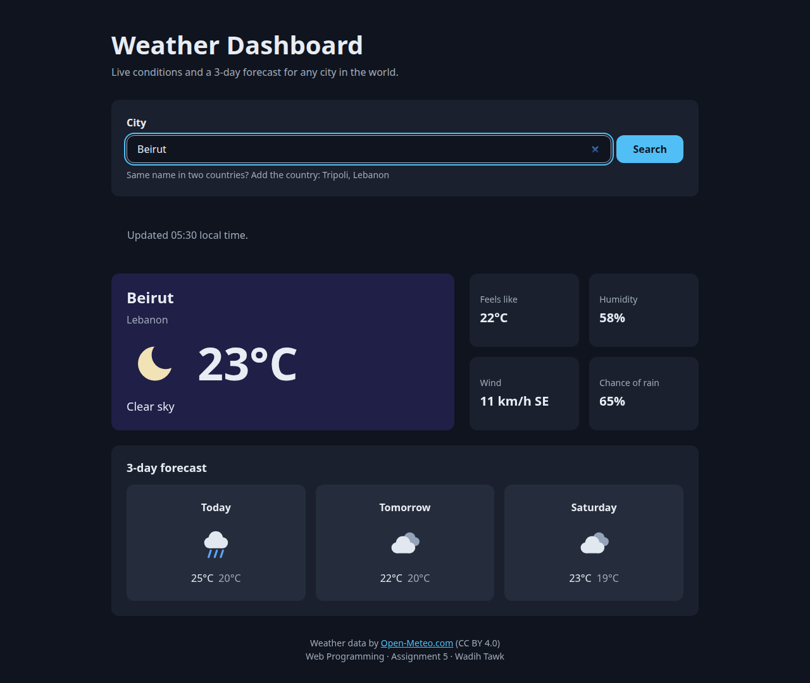
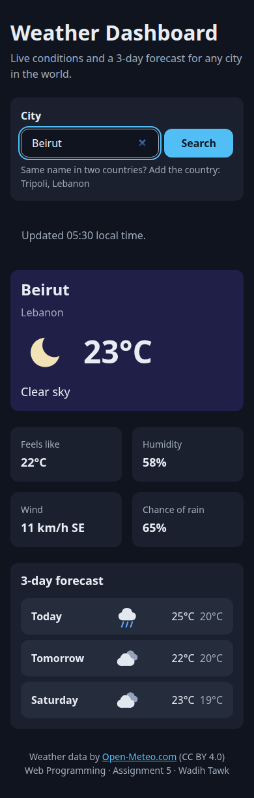
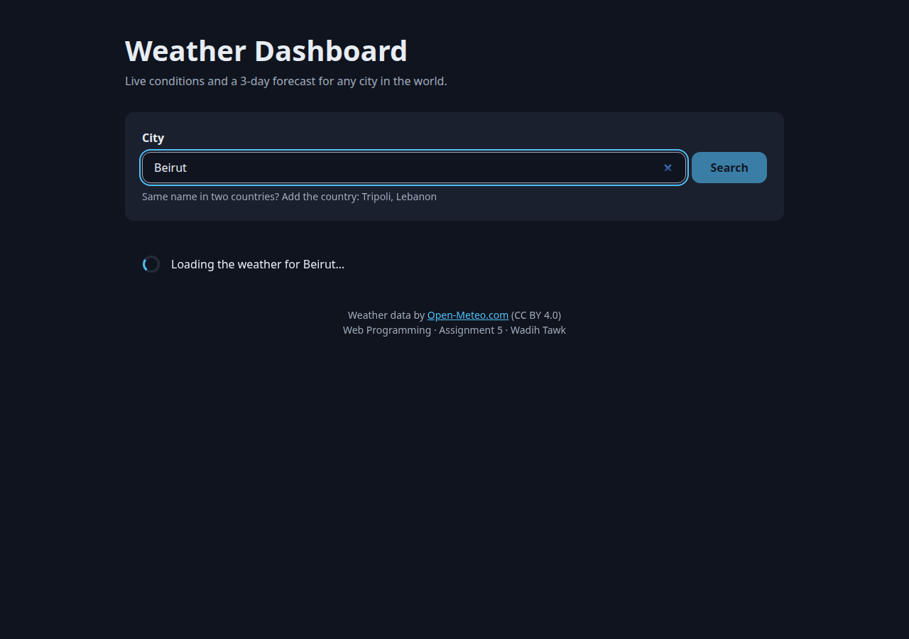
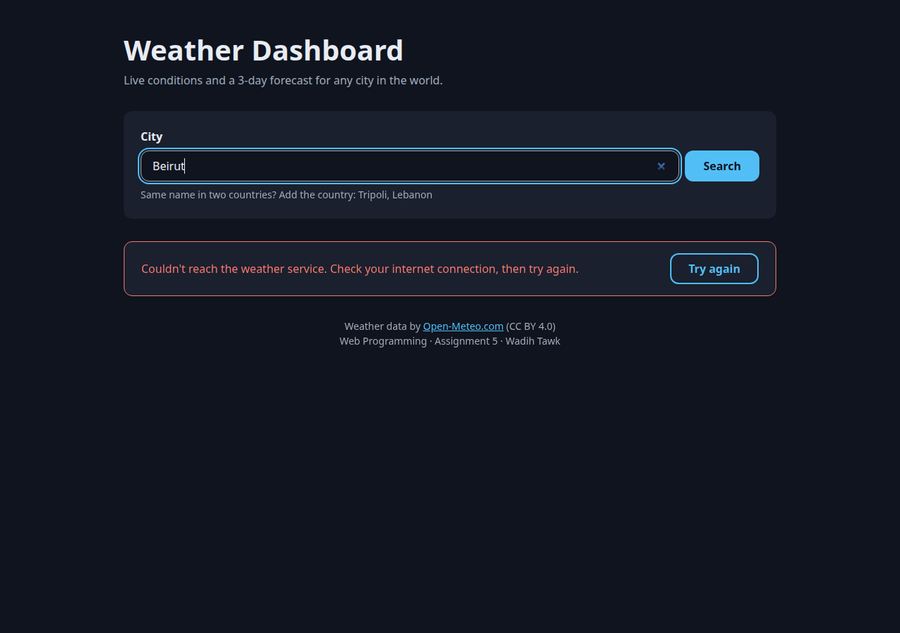
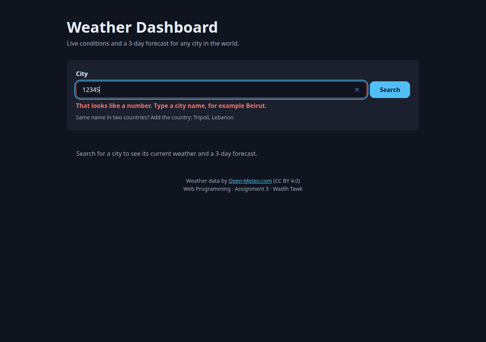

# Weather Dashboard in React (Assignment 5)

My Assignment 4 weather dashboard, rebuilt as a React application for the Web Programming course at USJ. Type a city and it fetches live data from the [Open-Meteo](https://open-meteo.com/) API: the current temperature, the conditions in words with an icon, feels-like, humidity, wind, today's chance of rain, and a 3-day forecast.

The UI is split into ten small function components. `App` owns the shared state, a `useEffect` hook fetches the data, and the page renders a loading, error or success state from that state.



## Install and run

You need [Node.js](https://nodejs.org/) **20.19 or newer** (Vite 8 requires it). Check with `node --version`.

```bash
npm install
npm run dev
```

Then open the address Vite prints, usually **http://localhost:5173**.

| Command | What it does |
|---|---|
| `npm install` | Downloads React, dayjs (dates), Vite and ESLint into `node_modules/` (run it once, after cloning or unzipping) |
| `npm run dev` | Starts the dev server; saving a file updates the page instantly |
| `npm run build` | Builds the optimized production version into `dist/` |
| `npm run preview` | Serves that `dist/` build locally |
| `npm run lint` | Checks the code with ESLint, including React's rules for hooks and dependency arrays |

**No API key is needed.** Open-Meteo is free for non-commercial use and works without a key, so there is no secret to configure and none in this repository.

## Features

- Search with the button or the Enter key. Add the country to choose between places with the same name: `Tripoli, Lebanon`, `Paris, Texas`
- Current conditions with a day or night icon, feels-like, humidity, wind with its compass direction, chance of rain today
- 3-day forecast with highs and lows
- **Loading** state: a spinner, and the Search button is disabled
- **Error** state: a specific message for each problem (unknown city, no internet, no answer within 10 seconds, too many requests, server error, unreadable answer), plus *Try again* when retrying can help
- **Success** state: the results, and the local time of the data
- Form validation under the field: empty input, or a number instead of a name. The message updates as you type and disappears once the input is fixed
- Responsive and mobile-first: one column on phones, the four values in one row on tablets, two columns from 1024px
- Accessible: a labelled input, `aria-invalid` on a wrong input, status changes announced to screen readers, alt text on forecast icons

## Component architecture

Every component is a function in its own file in `src/components/`.

```
App                     state: city, status, weather, error
├── Header
├── SearchBar           props: onSearch, isLoading        state: text, error
├── LoadingSpinner      props: message                    (shown while status is "loading")
├── ErrorMessage        props: message, onRetry           (shown when status is "error")
├── WeatherCard         props: place, current             (shown when status is "success")
├── WeatherDetails      props: current, rainChance
│   └── DetailItem ×4   props: label, value
├── Forecast            props: days
│   └── ForecastDay ×3  props: name, day
└── Footer
```

| Component | Its one job |
|---|---|
| `Header` / `Footer` | Page title and credits |
| `SearchBar` | The controlled search form: holds the text being typed, validates it on submit, and reports a clean city name to its parent through `onSearch` |
| `LoadingSpinner` | Shows a spinner and any message it receives |
| `ErrorMessage` | Shows an error message, and a *Try again* button only when it receives an `onRetry` function |
| `WeatherCard` | The current conditions: place, icon, temperature, conditions in words |
| `WeatherDetails` | Builds the list of four values and renders one `DetailItem` for each |
| `DetailItem` | One label/value tile (written once, used four times) |
| `Forecast` | Renders one `ForecastDay` per day with `.map()`, keyed by the date |
| `ForecastDay` | One day: name, icon, high and low |

The non-visual code is split by job, as in Assignment 4:

- `src/api.js` talks to Open-Meteo. It makes two requests (geocoding, then forecast), checks `response.ok`, and turns every failure into a named error. It also maps the API's field names to the app's own shape (`temperature_2m` → `temperature`, the parallel `daily` arrays → one `days` array).
- `src/format.js` holds pure helpers: weather codes to words and icons, units, compass points, day names, and error messages.

## State, props and the effect

### Where each piece of state lives

| State | Lives in | Why there |
|---|---|---|
| `city` | `App` | `SearchBar` changes it, and the effect, the loading message and the error message read it. `App` is the closest common parent (lifting state up). |
| `status` | `App` | One of `idle`, `loading`, `success`, `error`. It decides which state is rendered, disables `SearchBar`'s button, and starts the fetch. |
| `weather` | `App` | The fetched data, passed down to the three result components. |
| `error` | `App` | The last failure, turned into a message when rendering. |
| `text` | `SearchBar` | The half-typed text only matters to the input. `App` only needs the submitted city. |
| `error` (field) | `SearchBar` | The validation message under the field is local to the form. |

Some values are computed while rendering instead of being stored, so they can never get out of sync: `isLoading` (`status === 'loading'`), the error sentence, whether *Try again* is offered, every formatted value, and the day names.

### The data flow

Data goes down as props; events go up through callback props.

1. `SearchBar` validates the input, then calls `onSearch(city)`.
2. `App.handleSearch` stores the city and sets `status` to `'loading'`.
3. `useEffect` sees `status === 'loading'` and fetches the weather for `city`.
4. The result goes into state (`weather` or `error`) and `status` becomes `'success'` or `'error'`, so React renders the matching components.

*Try again* (`ErrorMessage`'s `onRetry`) only sets `status` back to `'loading'`, which repeats step 3 for the same city.

### The `useEffect` and its dependency array

Shortened from `src/App.jsx`:

```js
useEffect(() => {
  if (status !== 'loading') return;
  let ignore = false;
  // async load(): await loadWeather(city), then set weather/status, or error/status, unless ignore is true
  load();
  return () => { ignore = true; };
}, [city, status]);
```

- **`[city, status]`:** the effect reads both values, so both are in the array. `status` matters most here. If the effect ran only when `city` changed, searching for the same city again after a network error, or pressing *Try again*, would do nothing, because React skips an effect whose dependencies haven't changed. Every search and every retry passes through `'loading'`, so each one fetches.
- **The cleanup** runs before the effect runs again. If the city changes while a request is still on its way, the old request's late answer is thrown away (`ignore = true`) instead of replacing the newer city's data.
- The async work is an `async` function defined inside the effect and then called, because an effect itself must not be `async`.
- In development, React's StrictMode runs effects twice on purpose. The app still makes exactly two requests per search, because the effect only fetches while `status` is `'loading'`.

### Prop drilling

No state is passed more than **two levels** deep:

- `App` → `Forecast` → `ForecastDay`
- `App` → `WeatherDetails` → `DetailItem`

The components in the middle don't just pass the data along; they use it. `Forecast` loops over the days and works out each day's name, and `WeatherDetails` formats the values into a list. Everything else is one level, from `App` to a direct child.

Because nothing goes deeper, the app needs no Context: the data stays one or two levels from where it lives, so plain props remain the clearest option.

## Screenshots

| Desktop | Phone |
|---|---|
|  |  |

| Loading | Error | Validation |
|---|---|---|
|  |  |  |

## Project structure

```
index.html              the page shell: one empty <div id="root"> that React fills
public/
  favicon.svg
  icons/                10 weather icons (SVG, drawn for Assignment 4)
src/
  main.jsx              mounts <App /> into #root
  App.jsx               root component: state, the fetch effect, which state to render
  api.js                Open-Meteo requests and error handling
  format.js             pure formatting helpers
  index.css             all styles (design tokens, layout, states, responsive rules)
  components/           the ten components, one per file
screenshots/
eslint.config.js        ESLint rules, including React's hooks rules
vite.config.js          Vite with the React plugin
```

## Credits

Weather data by [Open-Meteo.com](https://open-meteo.com/), licensed under CC BY 4.0. Icons drawn for this project.
